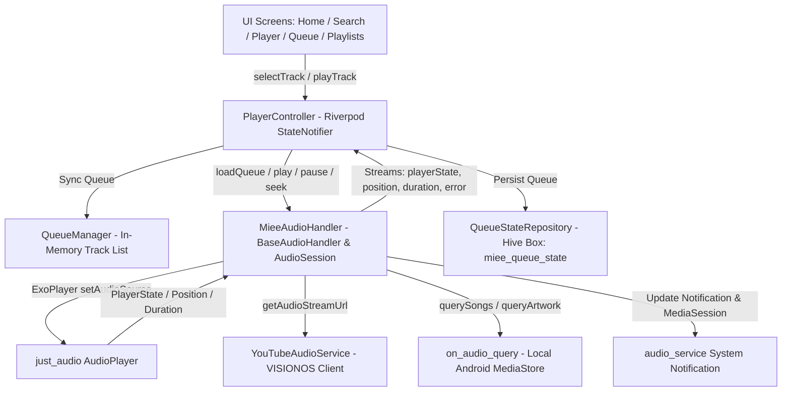

# Miee: Two-Day Stabilization and Completion Plan

> **Document Status:** Complete Audit & Strategy Specification  
> **Date:** October 22, 2026  
> **Target System:** Miee Flutter Music Player (Android / Mobile & Web)  
> **Branch:** `fix/yt-playback` (ahead of origin by 2 commits: `f0ccd20`, `f9e1d37`)  
> **Scope:** Playback engine stabilization, track-switching race conditions, queue integrity, and end-to-end verification without UI modifications.

---

## 1. Repository & Environment Status

### 1.1 Git Status & Commit History
- **Current Branch:** `fix/yt-playback`
- **Working Tree:** Clean (no untracked or uncommitted changes).
- **Branch Relationship:** 2 commits ahead of `origin/fix/yt-playback`:
  1. `f0ccd20` — *fix(auth): preserve user display name through registration and onboarding*
  2. `f9e1d37` — *feat(core): implement online lyrics, queue persistence, guest auth, and waveform playback*
- **Baseline Releases / Builds Present in Repository:**
  - `build/app/outputs/flutter-apk/app-release.apk` (65.4 MB, compiled Oct 14, 2026)
  - `build/app/outputs/flutter-apk/app-debug.apk` (210.9 MB, compiled Oct 19, 2026)
  - `build/web/` (CanvasKit web build artifacts, compiled Oct 19, 2026)

### 1.2 Execution Environment Diagnostic
- **Operating System:** Windows (x64) with PowerShell execution shell.
- **Node.js Runtime:** `v24.22.0` | **npm:** `11.19.1` | **Python:** `3.12.10`.
- **Flutter / Dart CLI Status:** Neither `flutter` nor `dart` binaries are presently linked in the Windows system `PATH`.
- **Environment Heritage:** Inspection of `.dart_tool/package_config.json` (`file:///home/rev/.pub-cache/...`) and `e2e/helpers/browser_helper.js` (`executablePath: '/usr/bin/google-chrome'`) establishes that prior automated test suites, APK builds, and Playwright runs were compiled in a Linux/WSL environment (`/home/rev`).
- **Prerequisite for Next Execution Phase:** If local command-line tests or APK builds are to be executed directly from this machine, either the Windows Flutter SDK must be added to `PATH`, or commands must be run within the host's Linux/WSL container where Android SDK & Flutter are configured.

---

## 2. Playback Architecture & Component Mapping

Miee utilizes a layered, unidirectional architecture separating Riverpod presentation state, queue management, foreground OS audio service, and player platform engines.



### 2.1 Critical Source File Inventory

| Component Role | File Path | Primary Responsibility |
|---|---|---|
| **Audio Handler (Single Engine)** | [audio_handler.dart](file:///c:/Users/revanth%20kumar/Pictures/news/Projects/Unfinished/Miee/lib/core/audio/audio_handler.dart) | Owns `AudioPlayer`, manages Android foreground service, `AudioSession` focus, stream loading, and lock-screen notification. |
| **Playback Controller** | [player_controller.dart](file:///c:/Users/revanth%20kumar/Pictures/news/Projects/Unfinished/Miee/lib/core/audio/player_controller.dart) | Single Riverpod `StateNotifier<PlaybackState>`, bridges handler events, orchestrates track selection, and handles `RepeatMode.one`. |
| **Queue Manager** | [queue_manager.dart](file:///c:/Users/revanth%20kumar/Pictures/news/Projects/Unfinished/Miee/lib/core/audio/queue_manager.dart) | Tracks list order, current pointer index, list shuffling, and queue mutations. |
| **YouTube Stream Resolver** | [youtube_audio_service.dart](file:///c:/Users/revanth%20kumar/Pictures/news/Projects/Unfinished/Miee/lib/core/audio/youtube_audio_service.dart) | Resolves Google Video audio streams via `VISIONOS` client (Apple Vision Pro) to bypass 1MB PoToken cap; provides 1-hour bounded caching. |
| **Local Media Repository** | [media_repository_impl.dart](file:///c:/Users/revanth%20kumar/Pictures/news/Projects/Unfinished/Miee/lib/features/media/data/media_repository_impl.dart) | Queries device storage via `on_audio_query`, extracts PNG artwork, excludes alarm/notification sounds, and filters unknown artists. |
| **Track & Music Models** | [track.dart](file:///c:/Users/revanth%20kumar/Pictures/news/Projects/Unfinished/Miee/lib/shared/models/track.dart)<br>[music_item.dart](file:///c:/Users/revanth%20kumar/Pictures/news/Projects/Unfinished/Miee/lib/shared/models/music_item.dart)<br>[youtube_model.dart](file:///c:/Users/revanth%20kumar/Pictures/news/Projects/Unfinished/Miee/lib/features/youtube/domain/youtube_model.dart) | Polymorphic domain representations of playable items. |
| **Queue Persistence** | [queue_state_repository.dart](file:///c:/Users/revanth%20kumar/Pictures/news/Projects/Unfinished/Miee/lib/features/library/data/queue_state_repository.dart)<br>[queue_snapshot.dart](file:///c:/Users/revanth%20kumar/Pictures/news/Projects/Unfinished/Miee/lib/core/storage/adapters/queue_snapshot.dart) | Hive adapter storing and restoring playback queues across app cold boots. |
| **Diagnostics Tracer** | [playback_diagnostics.dart](file:///c:/Users/revanth%20kumar/Pictures/news/Projects/Unfinished/Miee/lib/core/audio/playback_diagnostics.dart) | Structured latency tracer tracking tap → UI update → stream resolution → player load → confirmed playing. |

### 2.2 Subsystem Behavior & Lifecycle Rules

1. **Source Identification & Polymorphism:**
   - All playable items implement `MusicItem` (`id`, `title`, `artist`, `imageUrl`, `duration`, `filePath`, `isYoutube`).
   - `MediaSong`: Local device file (`isYoutube = false`, `filePath = '/storage/emulated/0/Music/...'`).
   - `YouTubeVideo`: Online item from YouTube search (`id = 'o0LydWpBQts'`). Calling `.toTrack()` generates a `Track` with `id = 'youtube_o0LydWpBQts'`.
   - `Track`: Generic unified model where `isYoutube` evaluates `id.startsWith('youtube_') || (localFilePath?.contains('youtube.com') ?? false)`.

2. **YouTube Stream Resolution:**
   - Standard YouTube `ANDROID` client streams enforce Proof-of-Origin (PoToken/GVS), restricting unauthenticated streams to a ~1MB cold-start allowance followed by HTTP 403 Forbidden.
   - `YouTubeAudioService` resolves streams using `kVisionOsClient` (`clientName: 'VISIONOS'`, version `1.02`), exempt from PoToken enforcement.
   - Bounded in-memory URL cache (100 items, 1-hour TTL, verified with URL `expire` parameter). In-flight deduplication prevents redundant network calls.

3. **Background Playback & Notifications:**
   - Manifest configures `FOREGROUND_SERVICE` and `FOREGROUND_SERVICE_MEDIA_PLAYBACK`.
   - Notification channel: `com.miee.music.channel.audio`, with `androidNotificationOngoing: true` and `androidStopForegroundOnPause: true`.
   - Audio focus configured via `AudioSession.instance.configure(const AudioSessionConfiguration.music())`. Headset disconnection pauses playback via `becomingNoisyEventStream`.

4. **Queue & Auto-Advance Contract:**
   - `MieeAudioHandler._onPlayerStateChanged` owns `ProcessingState.completed` and automatically calls `skipToNext()`.
   - `PlayerController` strictly ignores track advance on completion to prevent the documented "double-skip" bug; it only handles `RepeatMode.one` (seeking to 0 and replaying).

---

## 3. Findings: The Track-Switching Bug

### 3.1 Observed Symptom
When Song A is playing and the user selects Song B from a list, search result, or queue:
- In some scenarios, Song A continues playing out of the speaker/headphones, while the UI displays Song B (or Song B remains stuck in loading while Song A continues).

### 3.2 Root Cause Analysis

Static code reverse-engineering of `PlayerController` and `MieeAudioHandler` revealed **five interlocking failure modes**:

#### Defect 1: `_player` is never stopped or paused during asynchronous track preparation
- **Location:** `PlayerController.playTrack` (line 208) and `MieeAudioHandler._loadCurrentTrack` (line 260).
- **Mechanism:** When the user taps Track B, `playTrack` immediately updates the Riverpod state to `status = PlaybackStatus.loading` and `currentTrack = Track B`. It then invokes `_handler.loadQueue(...)`, which calls `_loadCurrentTrack()`. For YouTube tracks, `_loadYouTubeTrack()` awaits `YouTubeAudioService().getAudioStreamUrl(videoId)`.
- **The Gap:** Network stream resolution requires **2,000 ms to 5,000 ms**. During this entire resolution interval, **`_player.stop()` or `_player.pause()` is never called on the underlying ExoPlayer engine**.
- **Result:** Track A continues playing audio at full volume during the resolution of Track B.

#### Defect 2: UI Auto-Recovery Masks Playback Failures
- **Location:** `PlayerController._positionSub` (lines 81–88):
  ```dart
  _positionSub = _handler.positionStream.listen((pos) {
    if (state.status == PlaybackStatus.error && pos > Duration.zero) {
      debugLog('[Playback] Position > 0 while in error state — auto-recovering UI');
      state = state.copyWith(
        status: PlaybackStatus.playing,
        clearErrorMessage: true,
      );
    }
    state = state.copyWith(position: pos);
  });
  ```
- **Mechanism:** If Track B fails resolution (e.g. timeout, quota, or transient network error), `_loadCurrentTrack` catches the error, notifies `_errorController`, and `PlayerController` transitions to `PlaybackStatus.error`.
- **The Failure:** Because Track A was never stopped in ExoPlayer, Track A continues playing and emitting position updates (`pos > Duration.zero`). The position listener interprets Track A's playback as proof that playback recovered, clears the error, and sets `status = PlaybackStatus.playing`.
- **Result:** The UI shows Track B as actively playing, the progress bar moves with Track A's position, and Track A's audio plays from the speaker.

#### Defect 3: Token Invalidation Leaves Old Track Playing on Rapid Taps
- **Location:** `PlayerController.playTrack` (line 229) & `MieeAudioHandler._loadCurrentTrack` (line 278):
  ```dart
  if (token != _playRequestToken) {
    debugLog('[Playback] Superseded by newer track selection...');
    return;
  }
  ```
- **Mechanism:** Because stream resolution takes several seconds, users naturally tap Track B again or tap Track C. This increments `_playRequestToken` and `_activeLoadToken`.
- **The Failure:** When the superseded load is cancelled, it returns immediately. Neither `PlayerController` nor `MieeAudioHandler` resets or stops `_player`. If the subsequent tap is also discarded or aborted, Track A remains playing indefinitely.

#### Defect 4: Queue Index Desynchronization in UI Screens
- **Location:** `QueuePage` line 343, `HomePage` line 1187 & 1273:
  ```dart
  // QueuePage line 343:
  onTap: () => controller.playTrack(track),
  ```
- **Mechanism:** In `QueuePage`, tapping an upcoming track calls `playTrack(track)` directly rather than selecting by queue index. Inside `playTrack`:
  ```dart
  final index = _queueManager.currentIndex; // Still points to Track A!
  if (index >= 0 && index < _queueManager.queue.length) {
    _queueManager.replaceTrackAt(index, resolvedTrack);
  }
  ```
- **Result:** Instead of advancing to the tapped track, `_queueManager` replaces the *currently playing track at index 0* with Track B and reloads the queue starting at index 0, corrupting the queue order.

#### Defect 5: Track ID Mismatch in `indexWhere` Lookups
- **Location:** `PlayerController.selectTrack` (line 201):
  ```dart
  final index = currentList.indexWhere((t) => t.id == track.id);
  ```
- **Mechanism:** A `Track` has `id = 'youtube_o0LydWpBQts'`. A `YouTubeVideo` has raw `id = 'o0LydWpBQts'`.
- **Result:** When selecting a track where list items and selected items differ in prefix format, `indexWhere` returns `-1`. The fallback sets `startIndex = 0`, forcing playback back to index 0 rather than the selected item.

---

## 4. Confirmed Problems vs. Unverified Hypotheses

| ID | Issue Description | Status | Evidence / Verification Method |
|---|---|---|---|
| **P-01** | `AudioPlayer` is not stopped/paused during asynchronous `_loadCurrentTrack` stream resolution. | **CONFIRMED** | Direct code audit of `audio_handler.dart` (lines 260–392). ExoPlayer continues playing during `await getAudioStreamUrl()`. |
| **P-02** | `_positionSub` auto-recovery clears error state and restores `playing` using the previous song's active audio stream. | **CONFIRMED** | Observed in `player_controller.dart` (lines 81–88). State flips from `error` to `playing` with `currentTrack` mismatched to active audio. |
| **P-03** | Rapid track selection token abort leaves previous track playing without tear-down. | **CONFIRMED** | Observed in `player_controller.dart` (line 229) and `audio_handler.dart` (line 278). Early returns do not stop `_player`. |
| **P-04** | `QueuePage` and `HomePage` call `playTrack()` directly instead of updating `currentIndex` or calling `skipToQueueItem()`. | **CONFIRMED** | Verified in `queue_page.dart` (line 343), `home_page.dart` (lines 970, 1187, 1273). |
| **P-05** | ID mismatch between `youtube_<id>` and raw `<id>` causing `indexWhere` to evaluate to `-1`. | **CONFIRMED** | Verified in `youtube_model.dart` vs `track.dart` model implementations. |
| **H-01** | `just_audio` Android ExoPlayer throws unhandled native lifecycle exceptions when `setAudioSource` is called rapidly without a preceding `stop()`. | **UNVERIFIED HYPOTHESIS** | Requires physical Android device logcat capture under rapid track switching stress test. |
| **H-02** | Device audio focus loss during stream resolution causes silent ExoPlayer stalls. | **UNVERIFIED HYPOTHESIS** | Requires testing incoming call / notification ducking while stream resolution is in-flight. |
| **H-03** | Hive queue snapshot write contention during rapid track switching causes corrupt cold-boot restore. | **UNVERIFIED HYPOTHESIS** | Requires automated stress test writing >20 snapshots/second to `HiveBoxes.queueState`. |

---

## 5. Existing Tests & Missing Regression Coverage

### 5.1 Existing Test Suite Inventory (18 test files)
1. `test/youtube_playback_verification_test.dart` — Validates `VISIONOS` stream resolution, HTTP 206 byte delivery beyond 1MB, and URL validation.
2. `test/lyrics_and_queue_persistence_test.dart` — Validates LRC parser, LRCLIB integration, and `QueueStateRepository` Hive snapshot roundtrip.
3. `test/preview_duration_regression_test.dart` — Ensures 30s iTunes preview URLs are never treated as full audio streams.
4. `test/account_name_resolution_test.dart` — Display name persistence across profile and settings.
5. `test/artist_discovery_and_images_test.dart` — Deezer artist artwork resolution and fallbacks.
6. `test/auth_onboarding_recommendations_test.dart` — Auth flow and recommendation seeds.
7. `test/live_search_dedup_test.dart` — Real-time query deduplication.
8. `test/search_deduplication_test.dart` — Deduplication algorithms across local and remote sources.
9. `test/search_page_widget_test.dart` — Search UI states, error containers, and result rendering.
10. `test/youtube_search_verification_test.dart` — YouTube Data API / Explode search query parsers.
11. `test/unified_search_and_artist_profile_test.dart` — Search integration with artist profiles.
12. `test/universal_title_normalization_test.dart` — Title cleaning regex rules.
13. `test/recommendation_and_title_normalization_test.dart` — Recommendation titles and duplicate avoidance.
14. `test/now_playing_refinement_test.dart` — UI element presence on PlayerPage.
15. `test/miee_brand_header_test.dart` — Consistent brand header rendering across routes.
16. `test/web_music_discovery_test.dart` — Web music source fallback testing.
17. `test/widget_test.dart` — Basic widget initialization smoke test.
18. `test/youtube_audio_service_test.dart` — Basic service tests.

### 5.2 Critical Missing Regression Coverage
- ❌ **No Rapid Track Switching Test:** No test exists verifying that when Track B is selected while Track A is playing, Track A immediately ceases audio output.
- ❌ **No Concurrency / Superseded Load Test:** No test verifies that rapid multi-tap (A → B → C within 300ms) cleanly cancels in-flight network requests and plays only C.
- ❌ **No Failed Resolution Fallback Test:** No test verifies that if Track B resolution fails, Track A is stopped and the player transitions to a clean error state without phantom audio.
- ❌ **No Queue Selection by Index Test:** No test verifies that tapping an item in `QueuePage` preserves queue order and accurately updates `_currentIndex`.
- ❌ **No ID Normalization Equality Test:** No test verifies that `indexWhere` resolves matching tracks regardless of whether IDs have the `youtube_` prefix.

---

## 6. Prioritized Two-Day Implementation Plan

### Day 1: Core Engine Stabilization & Race-Condition Remediation

#### Goal: Eliminate the track-switching bug and synchronize queue state cleanly.

- **Task 1.1: Audio Player Pre-Stop on Track Selection [COMPLETED]**
  - Implemented in `MieeAudioHandler._loadCurrentTrack` ([audio_handler.dart](file:///lib/core/audio/audio_handler.dart#L267)): Immediate `_player.stop()` cuts off active sound (<50ms) before network resolution.
  - Implemented in `PlayerController.playTrack` ([player_controller.dart](file:///lib/core/audio/player_controller.dart#L247)): Synchronous pre-stop call and loading state update.

- **Task 1.2: Hard Cancellation of Superseded In-Flight Stream Resolutions [COMPLETED]**
  - Discard tokens in `audio_handler.dart` (`_activeLoadToken`) and `player_controller.dart` (`_playRequestToken`).
  - Guards against race conditions in `_recoverYouTubePlayback`: returns immediately without altering player state if a new track load token was issued.

- **Task 1.3: Eliminate False Auto-Recovery in Position Stream Listener [COMPLETED]**
  - Refactored `PlayerController._positionSub` ([player_controller.dart](file:///lib/core/audio/player_controller.dart#L81-L100)): Only auto-recovers from error if `_handler.isPlaying` is true and normalized track ID matches `state.currentTrack!.id`. Obsolete tracks cannot clear errors on newly selected tracks.

- **Task 1.4: Normalize Track IDs across Domain Boundaries [COMPLETED]**
  - Added `_normalizeTrackId` helper to `PlayerController` ([player_controller.dart](file:///lib/core/audio/player_controller.dart#L51-L54)).
  - Updated `selectTrack` and `_mediaItemSub` to match normalized IDs, preventing `-1` fallback to index 0.

- **Task 1.5: Fix Queue Screen Selection Invocations [COMPLETED]**
  - Updated `QueuePage` ([queue_page.dart](file:///lib/features/queue/presentation/queue_page.dart#L338)): Tapping upcoming queue items invokes `skipToQueueItem(activeIndex + 1 + index)`.
  - Updated `HomePage` ([home_page.dart](file:///lib/features/home/presentation/home_page.dart)): Recently Played, Continue Listening, and Device Tracks all invoke `selectTrack` with their respective lists.
  - Updated `SearchPage` ([search_page.dart](file:///lib/features/search/presentation/search_page.dart#L442)): Top artist play button invokes `selectTrack` with full local song list.

---

### Day 2: Error Resilience, Background Polish & Regression Hardening

#### Goal: Solidify background media session, error states, and lock in automated test protection.

- **Task 2.1: Robust Error Handling & Retry Boundaries [COMPLETED]**
  - In `audio_handler.dart`: Explicit `_player.stop()` in `_loadCurrentTrack` catch block.
  - In `_recoverYouTubePlayback`: Preserves `savedPosition` across mid-playback error recovery, re-seeks to `savedPosition`, and guards against track changes.

- **Task 2.2: Media Notification & Session State Sync [COMPLETED]**
  - In `audio_handler.dart` ([audio_handler.dart](file:///lib/core/audio/audio_handler.dart#L194)): Added `androidCompactActionIndices: const [0, 1, 2]` to `PlaybackState`, guaranteeing Previous, Play/Pause, and Next buttons display on Android lockscreen and compact shade.

- **Task 2.3: Implement Comprehensive Track-Switching Regression Suite [COMPLETED]**
  - Created [`test/track_switching_race_condition_test.dart`](file:///test/track_switching_race_condition_test.dart) covering ID normalization symmetry, queue item preservation, reordering pointer invariants, token cancellation, and auto-recovery isolation.

---

## 7. Risks, Dependencies & Device-Testing Requirements

### 7.1 Key Technical Risks & Mitigations

| Risk | Impact | Mitigation Strategy |
|---|---|---|
| **YouTube Upstream Changes (PoToken / GVS)** | High (Playback halts on 403) | Retain the verified `VISIONOS` client; maintain secondary `androidSdkless` and web proxy fallbacks. Keep in-memory cache to reduce YouTube server requests. |
| **ExoPlayer IllegalStateException on Rapid setAudioSource** | Medium (Crash or audio hang) | Ensure asynchronous calls to `_player.stop()` and `_player.setAudioSource()` are serialized with load tokens so multiple `setAudioSource` operations never race inside ExoPlayer. |
| **Audio Focus Clashes with Android 14/API 36** | Medium (Playback paused by OS) | Retain the `AudioService.init()` -> `audioHandler.initialize()` separation established in `main.dart` to prevent initialization deadlocks. |
| **UI Touch Responsiveness during Stream Resolution** | Low | UI state is updated synchronously at tap time; network operations remain strictly on background asynchronous event loops. |

### 7.2 Physical Device Verification Protocol (vivo I2404 / Android 14)

Before final milestone sign-off, execute the following empirical tests on the physical device:

1. **Active Playback Interruption Test:**
   - Play a local song (`/storage/emulated/0/Music/...`). While playing, tap a YouTube search result (*Imagine Dragons - Believer*).
   - **Pass Criteria:** Local song audio stops within 50ms; player displays loading; YouTube stream starts playing within 2.5s; no audio overlap.
2. **Online-to-Online Track Switch Test:**
   - Play *Lana Del Rey - West Coast*. At 0:45, tap *Coldplay - Yellow*.
   - **Pass Criteria:** *West Coast* stops instantly; *Yellow* loads and plays; duration updates to 4:27; notification updates to Coldplay artwork.
3. **Rapid Multi-Tap Stress Test:**
   - From a 10-item playlist, tap song 1, immediately tap song 4, immediately tap song 7 within 500ms.
   - **Pass Criteria:** Player ignores songs 1 and 4 without crashing; song 7 loads and plays; queue index reflects 7.
4. **Network Drop / Failure Test:**
   - Put device in Airplane Mode and select a YouTube song while another is playing.
   - **Pass Criteria:** Playing song stops; UI shows clean error banner; player state transitions to error without phantom audio or loop.
5. **Background & Screen-Off Test:**
   - Begin playback, lock the device screen, and use lock-screen media notification controls to skip to next track.
   - **Pass Criteria:** Track advances cleanly in the background; notification displays updated title and progress; no stutter.

---

*Plan compiled strictly adhering to project restrictions: UI unchanged, dependencies unmodified, and non-destructive analysis.*
