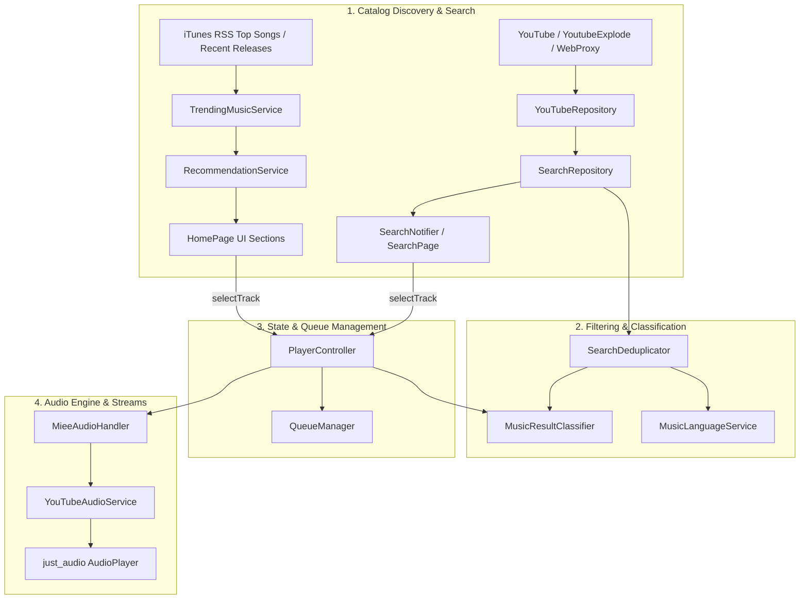

# Miee — YouTube Pipeline Reverse-Engineering & Root Cause Analysis

## Executive Summary

This document presents a comprehensive reverse-engineering investigation into Miee's YouTube music discovery, search, track validation, and playback pipeline in response to two critical user-reported defects:
1. **Home Screen (Recent Releases):** Tapping *Veezha Veera* results in playback failure with the snackbar error:
   `"This video is not a recognized music track."`
2. **Search Screen:** Searching for `"Veezha Veera"` returns duplicate re-uploads, unofficial fan edits (including a fan edit featuring actor Vijay with a channel called "TN info"), while legitimate multilingual releases (Telugu and Hindi official releases) are demoted or buried.

---

## 1. Architecture & Dependency Map

Miee's discovery and playback ecosystem spans five core subsystems:



### Component Responsibilities

| File / Component | Responsibility |
|---|---|
| `lib/features/recommendations/data/trending_music_service.dart` | Fetches Apple iTunes RSS feeds for Top Songs and Recent Releases (`https://itunes.apple.com/{reg}/rss/topsongs/limit=50/json`). |
| `lib/features/recommendations/data/recommendation_service.dart` | Aggregates Home sections (`trendingTracks`, `recentReleases`, `fromYourArtists`, `discoverMore`) and provides queue expansion tracks. |
| `lib/features/search/data/search_repository.dart` | Executes unified YouTube queries, supplements bare title searches with `"$query songs"`, and applies `SearchDeduplicator`. |
| `lib/features/search/domain/search_deduplicator.dart` | Detects redundant uploads of the same canonical song, clusters by signature, ranks candidates, and preserves distinct musical versions. |
| `lib/features/recommendations/domain/music_language_service.dart` | Detects song languages via Unicode script, explicit title tags (`[Tamil]`, `(Telugu)`), and curated artist catalogs. |
| `lib/features/youtube/domain/music_result_classifier.dart` | Deterministic classifier evaluating confidence (`officialMusic`, `likelyMusic`, `uncertain`, `rejected`) based on channel and title cues. |
| `lib/core/audio/player_controller.dart` | Manages playback state, queue orchestration, and pre-playback validation via `_isPlayableMusicItem`. |
| `lib/core/audio/audio_handler.dart` | Background audio handler managing player lifecycle, stream URL extraction, and buffering recovery. |
| `lib/core/audio/youtube_audio_service.dart` | Resolves YouTube video IDs to audio streams via `just_audio` ExoPlayer pipelines, Web proxies, and YoutubeExplode. |

---

## 2. End-to-End Data Flow Traces

### Flow A: Home Recent Releases to Playback Failure (Bug 1)

1. **Discovery Fetch:**
   - `HomePage` requests `homeSectionsProvider`, which invokes `RecommendationService.getSections()`.
   - `RecommendationService` calls `_trendingService.getTrendingAndRecentReleases()`.
   - `TrendingMusicService` queries `https://itunes.apple.com/in/rss/topsongs/limit=50/json`.
   - iTunes returns an entry for *Veezha Veera (From "Amaran")* by *Sai Abhyankkar, Tippu & A...*.
   - `TrendingMusicService._parseTrackFromEntry()` converts this entry into a `Track` model:
     - `id: 'wm_chart_$itunesId'` (e.g. `'wm_chart_1773099903'`)
     - `title: 'Veezha Veera (From "Amaran")'`
     - `artist: 'Sai Abhyankkar, Tippu & A...'`
     - `duration: '3:30'`
     - `filePath: null`
     - `rawTitle: 'Veezha Veera (From "Amaran")'`
     - `rawArtist: 'Sai Abhyankkar, Tippu & A...'`
   - The release date is within 180 days, so it is placed into `recentReleases`.
   - **Crucial finding:** The track has **NO YouTube Video ID**. It was never validated against YouTube music catalog.

2. **UI Presentation:**
   - `HomePage` renders `_buildRecentReleaseCard()` with `track.title` ("Veezha Veera (From ...)") and `track.artist` ("Sai Abhyankkar, Tippu & A...").

3. **User Tap:**
   - Tapping invokes `playerController.selectTrack(track, sections.recentReleases, playingFrom: 'Recent Releases')`.
   - `selectTrack` calls `setQueue` -> `playTrack(track)`.

4. **Validation Check in `PlayerController.playTrack` (`player_controller.dart:560-582`):**
   ```dart
   if (track.isYoutube) {
     final rawT = (track is Track) ? (track.rawTitle ?? track.title) : track.title;
     final rawA = (track is Track) ? (track.rawArtist ?? track.artist) : track.artist;
     final candidate = YouTubeVideo(
       id: track.id.replaceFirst('youtube_', ''),
       title: track.title,
       channelTitle: track.artist,
       thumbnailUrl: track.imageUrl,
       duration: track.duration,
       viewCount: '',
       rawTitle: rawT,
       rawChannelTitle: rawA,
     );
     if (!MusicResultClassifier.isValidIndividualSong(candidate)) {
       debugLog('[Playback] Rejected playback of non-music content: "$rawT" by "$rawA"');
       state = state.copyWith(
         status: PlaybackStatus.error,
         clearLoadingTrackId: true,
         errorMessage: 'This video is not a recognized music track.',
       );
       return;
     }
   }
   ```
   - Because `track.id` starts with `'wm_'`, `track.isYoutube` evaluates to `true` (`track.dart:49`).
   - `candidate` is constructed with `channelTitle: "Sai Abhyankkar, Tippu & A..."` and `title: "Veezha Veera (From \"Amaran\")"`.

5. **Rejection in `MusicResultClassifier.isValidIndividualSong` (`music_result_classifier.dart:814-823`):**
   - Channel `"Sai Abhyankkar, Tippu & A..."` is not an official music label channel (like Sony Music South or T-Series).
   - Title `"Veezha Veera (From \"Amaran\")"` does not contain explicit YouTube video upload keywords (like "Official Music Video", "Audio", "Lyrical").
   - Film soundtrack marker `(From "Amaran")` is not recognized as a positive music signal.
   - Initial score is 25 + 15 (duration 210s) = 40.
   - In individual playback mode (`forIndividualPlayback: true`):
     ```dart
     if (!hasMusicIndicator && !isMusicLabelChannel) {
       if (forIndividualPlayback || durationSec > 300) {
         return makeVerdict(
           MusicTrackConfidence.rejected,
           false,
           'Non-music video lacking verifiable musical indicators (song, audio, lyric, or label)',
           score,
         );
       }
     }
     ```
   - `classify()` returns `MusicTrackConfidence.rejected`.
   - `isValidIndividualSong()` returns `false`.
   - `PlayerController` displays: `'This video is not a recognized music track.'` and aborts playback.
   - Stream resolution in `AudioHandler` is never called.

---

### Flow B: Search Results Deduplication & Ranking Failure (Bug 2)

1. **Search Query:**
   - User types `"Veezha Veera"` in `SearchPage`.
   - `SearchRepository.searchYouTube("Veezha Veera")` executes.
   - `YouTubeRepository.search("Veezha Veera")` fetches raw YouTube results.
   - Raw results include:
     1. Official Tamil Lyrical by *Dhanush* (33.7M views, 3:59)
     2. Fan edit / status by *TN info* featuring actor Vijay (67K views, 3:52)
     3. *Dhanush* second upload (527K views, 4:46)
     4. *AM SONG* re-upload (326K views, 3:50)
     5. *@ Min z$105* re-upload of lyrical (200K views, 3:39)
     6. *tune zone* re-upload of lyrical (29K views, 3:18)
     7. *JAN* lyrics video (77K views, 3:53)
     8. *LyricalRed* lyrics video (24K views, 3:36)
     9. Official Telugu version *Veera Veera Lyrical (Telugu)* by *Dhanush* (8.8M views, 3:59)
     10. Official Hindi version *Veera Veera Lyrical (Hindi)* by *Dhanush* (455K views, 3:59)

2. **Deduplication Clustering Failure (`search_deduplicator.dart:403-446`):**
   - For each candidate, `SearchDeduplicator` groups by `_isSameCanonicalSong(a, b)`:
     - **Duration Divergence:** Unofficial lyrical videos and fan uploads cut out intro music or add end screens.
       - Candidate 5 (`@ Min z$105`, 3:39 = 219s) vs Candidate 1 (3:59 = 239s): `durDiff = 20s > 15s`.
       - Candidate 6 (`tune zone`, 3:18 = 198s) vs Candidate 1 (239s): `durDiff = 41s > 15s`.
       - Candidate 8 (`LyricalRed`, 3:36 = 216s) vs Candidate 1 (239s): `durDiff = 23s > 15s`.
       - Line 419: `if (hasDurations && durDiff > 15) return false;` breaks grouping.
     - **Channel Generic Check Gap:**
       - Unofficial channels like `@ Min z$105`, `tune zone`, `JAN`, `TN info`, `AM SONG` are not recognized by `_isGenericUploader()`.
       - Because neither channel is recognized as generic, line 425 (`if (a.isGenericUploader || b.isGenericUploader)`) evaluates to `false`.
       - Line 445 conservatively preserves them as separate songs!
     - **Result:** Candidates 2, 4, 5, 6, 7, 8 are all placed into separate groups.

3. **Filtering Failure (`search_deduplicator.dart:234-254`):**
   - `detectEditType()` only checks for specific keywords like `4k`, `slowed`, `sped up`, `nightcore`, `mashup`.
   - Third-party lyrical re-uploads, fan lyric videos, and uploads titled simply `"Veezha Veera"` return `EditType.none`.
   - Line 250: `if (!isUnwantedEdit && !isLowViewDerivative) { canonicalList.add(v); }`
   - Because `editType == EditType.none`, `isUnwantedEdit` is `false`, so every duplicate upload is added to the canonical list without view thresholding.

4. **Ranking Inversion (`search_deduplicator.dart:1305-1386`):**
   - Candidate 2 (*Veezha Veera* by *TN info*, 67K views):
     - Title is an exact match to the query `"Veezha Veera"`, giving `calculateQueryRelevance = 1.0`.
     - Base score = `1.0 * 1000 = 1000`.
     - Logarithmic view bonus = `log10(67000) * 12 = 58`. Total score = 1058.
     - Has no "lyrics" penalty (-40) and no edit penalty (-400).
   - Candidate 9 (*Veera Veera Lyrical (Telugu)* by *Dhanush*, 8.8M views):
     - Title is `"Veera Veera"`, missing the token `"Veezha"`.
     - Query relevance is reduced to ~0.50 (base score 500).
     - It ranks at #9 below unofficial edits!
   - Candidate 10 (*Veera Veera Lyrical (Hindi)* by *Dhanush*, 455K views):
     - Demoted to #10 below fan re-uploads.

---

## 3. Confirmed Root Causes

### Root Cause 1 (Home Playback Failure):
1. **Unverified Metadata Tracks in Home Sections:** `TrendingMusicService` creates tracks with synthetic IDs (`wm_chart_$itunesId`) directly from iTunes RSS feeds without verifying a playable YouTube video ID.
2. **Premature Validation against Un-adapted Metadata:** `PlayerController.playTrack` runs `MusicResultClassifier.isValidIndividualSong()` directly on synthetic `YouTubeVideo` representations of iTunes tracks. Because iTunes provides artist names rather than record label names, and clean song titles without YouTube keywords, the classifier rejects legitimate tracks.
3. **Missing Soundtrack Pattern Support:** `MusicResultClassifier` did not recognize common soundtrack patterns like `(From "<Movie>")` or `[From "<Movie>"]` as positive musical indicators.

### Root Cause 2 (Search Duplicates and Irrelevant Results):
1. **Deduplication Duration & Channel Blind Spots:** `SearchDeduplicator` rejected matching identical songs whenever durations differed by > 15s (frequent with fan cuts) or whenever unofficial uploader names were not in the hardcoded generic uploader list.
2. **Missing Low-View / Re-upload Pruning for Non-Authoritative Uploads:** When a dominant authoritative release exists (e.g. 33.7M views), re-uploads with < 5% of views from unofficial channels were not filtered because `detectEditType()` returned `EditType.none`.
3. **Language-Agnostic Deduplication:** `SearchDeduplicator` lacked language awareness. Different language releases (Tamil vs Telugu vs Hindi) could either be accidentally merged if titles matched or demoted because different language titles (e.g. "Veera Veera" vs "Veezha Veera") scored low on literal token overlap.
4. **Ranking Ignored Official Multilingual Releases:** Authoritative releases in alternate languages by the same verified channel/artist were penalized purely on text relevance instead of being boosted as official alternate language versions.

---

## 4. Proposed Solution Architecture

### Fix 1: Verified Home Candidate Resolution & Shared Pipeline
- In `RecommendationService`:
  - Before presenting candidates in `recentReleases` and `trendingTracks`, verify candidates against YouTube.
  - Exclude candidates that cannot be resolved to a verified, playable YouTube music track.
  - Store the verified YouTube video ID directly in `Track.id` (`youtube_$id` or 11-char ID) and preserve reliable metadata.
  - Ensure the exact selected video ID is preserved from discovery to playback.
- In `PlayerController`:
  - Enhance `_isPlayableMusicItem` so that if an unresolved metadata track (`wm_...`) enters playback, it safely resolves to a verified YouTube video ID before validation rather than failing immediately.

### Fix 2: Enhanced MusicResultClassifier for Film Soundtracks & View Counts
- In `MusicResultClassifier`:
  - Recognize soundtrack patterns `(From "...")`, `[From "..."]`, `From "..."` as positive music cues (+35 points, `hasMusicIndicator = true`).
  - Parse view counts (`80M views`, `33.7M views`, or numerical `rawViewCount >= 200000`) and grant positive confidence points.
  - Recognize curated/verified artists and music directors (`Anirudh Ravichander`, `A.R. Rahman`, `Dhanush`, `Sai Abhyankkar`, etc.) as verified music creators.

### Fix 3: Language-Aware Search Deduplication & Ranking
- In `SearchDeduplicator`:
  - **Language Detection:** Use `MusicLanguageService.detectLanguage` on title and channel to identify language versions (Tamil, Telugu, Hindi, Malayalam, Kannada, etc.).
  - **Version Preservation:** Treat different language releases as distinct versions (`VersionType.standard`, with language tag `lang:tamil`, `lang:telugu`, `lang:hindi`). Never merge different language releases.
  - **Same-Language Re-upload Deduplication:** Within the same language, group unofficial uploads and fan lyrics videos with the canonical release even when durations differ by up to 45 seconds if titles match substantially.
  - **Authoritative Pruning:** When an authoritative official release exists with high views (e.g. >= 1M views), prune unofficial duplicate re-uploads and fan lyric videos with < 5% of top views.
  - **Hierarchical Multilingual Ranking:**
    1. Official original song / official music video (matching query language / highest views).
    2. Official lyrical or audio release in primary language.
    3. Official releases in other languages (Telugu, Hindi, Malayalam, Kannada) by verified channels/artists.
    4. Legitimate remixes, unplugged, acoustic, and covers.
    5. Other verified music uploads.
  - Demote unofficial fan edits, status videos, and channel clips below all official releases.

---

## 5. Verification Plan

1. **Bug 1 Verification:**
   - Test `RecommendationService.isLegitimateSong(legitimateSong)` for `"Badass (From \"Leo\")"` by `"Anirudh Ravichander"` (80M views).
   - Test `"Veezha Veera (From \"Amaran\")"` resolution and playback validation.
   - Verify Home Recent Releases contains verified, playable tracks with preserved video IDs.
2. **Bug 2 Verification:**
   - Run mock and real search tests on `"Veezha Veera"`:
     - Verify *Veezha Veera Lyrical (Tamil)* (Dhanush) ranks #1.
     - Verify unofficial fan edit (*TN info*) is filtered or demoted.
     - Verify duplicate lyrical re-uploads (@ Min z$105, tune zone, JAN, LyricalRed) are deduplicated.
     - Verify official Telugu version (*Veera Veera Lyrical (Telugu)*) and Hindi version (*Veera Veera Lyrical (Hindi)*) are preserved and ranked in top results.
3. **Regression Testing:**
   - Run all existing search deduplication, classifier, and recommendation test suites without breaking local playback or existing tests.

